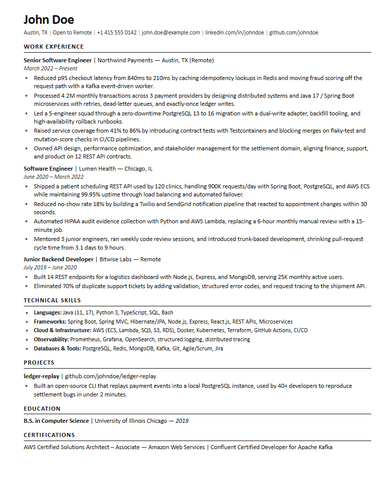

<div align="center">

# ATS Resume Builder

**ATS-friendly Software Engineer resumes, built, audited, and exported locally.**

<a href="https://github.com/criblab/ats-resume-builder/actions/workflows/validate.yml"></a> <a href="https://github.com/criblab/ats-resume-builder/releases/latest"></a> <a href="LICENSE"></a>    

<sub><b>English</b> · <a href="README.es.md">Español</a></sub>

</div>

An AI skill and a zero-dependency toolkit for building, tailoring, auditing, and exporting **ATS-friendly Software Engineer resumes** from Markdown.

It combines a structured writing workflow (the Google XYZ formula, exact JD keywords, single-column formatting) with local scripts that produce a clean HTML/PDF and check the result before you apply. No accounts, no uploads, no resume builder subscription.

<p align="center">
  
</p>

<details>
<summary><b>Contents</b></summary>

- [Why this exists](#why-this-exists)
- [Scope / What this is not](#scope--what-this-is-not)
- [What you get](#what-you-get)
- [Quick start](#quick-start)
- [Use it as an AI skill](#use-it-as-an-ai-skill)
- [From zero: what a new user actually does](#from-zero-what-a-new-user-actually-does)
- [The workflow](#the-workflow)
- [Build commands](#build-commands)
- [Validation](#validation)
- [Customization](#customization)
- [Repository structure](#repository-structure)
- [Privacy](#privacy)
- [Limitations](#limitations)
- [Contributing](#contributing)
- [License](#license)

</details>

## Why this exists

Most resume advice is either formatting superstition or keyword stuffing. This project takes a narrower position:

- ATS platforms are searchable databases and knockout-question engines, not magic rejectors.
- Clean, single-column text gets parsed. Exact, truthful keywords get found. Evidence gets read.
- A resume that lies is worse than a resume that scores 70.

The workflow is designed so the AI never invents metrics, never hides gaps with fake dates, and never trades truth for a keyword score.

## Scope / What this is not

**It is built for Software Engineer roles.** The workflow, keyword bank, action verbs, examples, and most validation rules target backend, frontend, full-stack, mobile, data, ML, DevOps, SRE, QA, and security engineering roles.

**The engine works for almost any profession.** Markdown -> HTML -> PDF, single-column formatting, the XYZ bullet formula, the master-resume -> tailored-variant model, the copy-paste parse test, and the structural checks are field-agnostic. You can use the exporter and the formatting rules for a nursing, legal, design, or finance resume today.

**The content intelligence is tech-biased.** If you run a non-engineering resume through the validator, expect:

- a GitHub warning that does not apply to your field;
- lower keyword coverage because the bank lacks clinical, legal, finance, or design vocabulary;
- section aliases and examples that assume tech projects and stacks.

It will still run and produce a clean PDF. It will not be as sharp as it is for engineering.

**What this is not:**

- Not a guarantee of interviews or a specific vendor's "ATS score".
- Not a generic resume writer for every industry yet. Field profiles are not included.
- Not an application autofill tool or a career coach.
- Not permission to invent metrics, titles, dates, or credentials.

For non-tech use, treat it as a formatting and export toolkit, then replace `references/keyword-bank.md` and the examples with your field. A `--profile healthcare` / `--profile finance` system is the natural next step, but it is not implemented.

## What you get

| File | What it does |
| :--- | :--- |
| `SKILL.md` | The workflow: intake, JD extraction, tailoring, bullet rules, validation |
| `templates/resume.md` | Fill-in Markdown skeleton |
| `templates/resume.css` | ATS-safe print stylesheet (Letter or A4) |
| `scripts/build.mjs` | Markdown -> HTML -> PDF using your installed Chrome/Edge/Chromium |
| `scripts/ats-check.mjs` | Local audit: formatting, evidence, dates, length, privacy, keyword coverage |
| `references/` | Action verbs, keyword bank, scoring rubric, parsing guide, edge cases, cover letter |
| `examples/` | Fictional master resume + job description that score 98/100 |

## Quick start

The only requirement is **Node.js 18+**. Nothing is downloaded or uploaded: no accounts, no API keys, no installer.

```bash
git clone https://github.com/criblab/ats-resume-builder.git
cd ats-resume-builder

# Audit the example (no install step)
npm test

# Build HTML + PDF
npm run build

# dist/John-Doe-Resume.html
# dist/John-Doe-Resume.pdf
```

## Use it as an AI skill

This repo is a standard **Agent Skills** package: a `SKILL.md` folder plus `scripts/` and `references/`. The format is vendor-neutral, so the same copy runs in every agent that implements it.

| Agent | Project | Global |
| :--- | :--- | :--- |
| Claude Code | `.claude/skills/` | `~/.claude/skills/` |
| Codex | `.codex/skills/` | `~/.codex/skills/` |
| Cursor | `.cursor/skills/` | `~/.cursor/skills/` |
| GitHub Copilot | `.github/skills/` | `~/.copilot/skills/` |
| Gemini CLI | `.gemini/skills/` | `~/.gemini/skills/` |
| OpenCode | `.opencode/skills/` | `~/.config/opencode/skills/` |
| Amp | `.agents/skills/` | `~/.config/agents/skills/` |

The only contract is `SKILL.md`: YAML frontmatter with `name` and `description`, then Markdown. No plugin, no registry, no adapter.

### Install

Clone once into the global folder of your agent, swapping the path from the table:

```bash
git clone https://github.com/criblab/ats-resume-builder.git \
  ~/.claude/skills/ats-resume-builder
```

```powershell
# Windows (PowerShell)
git clone https://github.com/criblab/ats-resume-builder.git `
  "$env:USERPROFILE\.claude\skills\ats-resume-builder"
```

For a single project, clone into `.claude/skills/`, `.codex/skills/`, `.cursor/skills/`, `.github/skills/`, `.gemini/skills/`, or `.opencode/skills/` inside the repository. Several agents also read `.agents/skills/` (OpenCode, Gemini CLI, Cursor, Amp), so that path is the closest thing to a shared location.

The content is plain Markdown, so it also works in agents that do not implement the standard yet: point the agent at the file (`Read SKILL.md and follow it`) or paste it into the tool's rules file (`AGENTS.md`, `CLAUDE.md`, `.cursor/rules`). The scripts behave the same, because they are just Node.

### Prompts that trigger it

- "Build a resume for a senior backend engineer in the US."
- "Tailor my resume to this job description and tell me what is missing."
- "Audit this resume for ATS parsing and weak bullets."
- "Export my resume to PDF and verify the text is selectable."
- "I have a 14-month gap. How do I handle it without lying?"

The skill asks for the target role, market, resume, and JD in one batch, then produces a master resume and a tailored variant rather than overwriting a single file.

## From zero: what a new user actually does

A typical first run, end to end:

1. **Finds the repo and reads the preview.** They see a one-page backend resume and a 98/100 example.
2. **Installs it** in one clone command (above) and opens their AI agent in any folder.
3. **Says what they need**, pasting the role and the job description:

   > "I have 3 years as a backend engineer in Colombia, targeting this Senior Backend role in the US. Here is my current CV and the JD. Build my master resume, tailor it, and export the PDF."

4. **Answers 4-6 questions in one batch**: target title, market, work authorization if relevant, missing metrics, strongest achievements, and anything they must not include.
5. **Gets two files**: `resume/master.md` (everything true and useful) and `resume/variants/acme-senior-backend.md` (the tailored version).
6. **Fills the gaps** marked `[ADD METRIC: ...]` and confirms every claim is defensible.
7. **Runs the validator and export**:

   ```bash
   node scripts/ats-check.mjs resume/variants/acme-senior-backend.md \
     --jd jd.txt --years 3 --output dist/First-Last-Resume.pdf

   node scripts/build.mjs resume/variants/acme-senior-backend.md \
     --out dist --name First-Last-Resume
   ```

8. **Does the copy-paste test** on the PDF, clicks the links, and applies with a resume that is one page, single column, and 80%+ matched to the JD.

No AI agent? Use the same repo manually: copy `templates/resume.md`, write the bullets, and run the two commands. The validator and exporter work the same.

**What they need:** Node 18+ and Git. No account, API key, subscription, or upload. First run usually takes 20-30 minutes, mostly thinking about metrics, not formatting.

## The workflow

```text
Intake -> Master inventory -> JD brief -> Select evidence -> Rewrite bullets
   -> Validate (script + manual parse) -> Export MD/HTML/PDF -> Apply
```

Key rules enforced by the skill:

- Single column, selectable text, standard headings, no tables/icons/photos.
- `Month Year – Month Year` dates, reverse chronology.
- 3-5 bullets for recent roles; 60%+ with numbers; every bullet with an outcome.
- One page under 5 years of experience; two pages maximum otherwise.
- No fabricated metrics. Missing numbers become `[ADD METRIC: ...]` until confirmed.
- 75-85% truthful coverage of must-have JD keywords, never keyword stuffing.

See [SKILL.md](SKILL.md) for the full workflow and [references/scoring-rubric.md](references/scoring-rubric.md) for the 100-point audit.

## Build commands

```bash
# HTML + PDF
node scripts/build.mjs resume/master.md --out resume/dist --name First-Last-Resume

# HTML only
node scripts/build.mjs resume/master.md --out resume/dist --no-pdf

# A4 for Europe/LATAM
node scripts/build.mjs resume/master.md --a4

# Denser layout when you must fit two pages
node scripts/build.mjs resume/master.md --font-size 9.2pt
```

| Flag | Default | Description |
| :--- | :--- | :--- |
| `--out <dir>` | `dist` | Output directory |
| `--name <base>` | input name | Output file name |
| `--title <text>` | derived | HTML title and PDF Title metadata |
| `--font-size <size>` | `9.4pt` | Body size (`9.4pt`, `13px`) |
| `--css <file>` | `templates/resume.css` | Custom stylesheet |
| `--lang <code>` | `en` | HTML language |
| `--a4` | off | A4 instead of US Letter |
| `--no-pdf` | off | HTML only |
| `--require-pdf` | off | Fail if the PDF cannot be generated |

PDF export tries `CHROME_PATH`, then Chrome, Edge, and Chromium at their standard locations. It uses a temporary browser profile, prints without headers/footers, and deletes the profile afterward. The resume never leaves your machine. If no Chromium-based browser is found, the HTML is still written: open it and print to PDF with margins set to none and background graphics enabled.

The print stylesheet also disables `fi`/`fl`/`ff` ligatures. Without that, PDF text extraction can return `notification` instead of `notification`, and keyword search misses the term.

## Validation

```bash
node scripts/ats-check.mjs resume/master.md --jd jd.txt --years 5 --output dist/First-Last-Resume.pdf
```

Example result from the included files:

```text
ATS CHECK  examples/master-resume.md
============================================================
Notes
  [i] Keywords: Missing or unmatched: millions, reliability, operate.

Summary
  [ok] 25 checks passed
  [i] 11 experience bullets, 439 words
  [i] Keyword coverage: 96% (95/99 weighted terms)
  Score: 98/100 (A)
```

The script checks:

- Contact data: name, email, phone, LinkedIn, GitHub.
- Prohibited formatting: tables, images, embedded HTML, emoji.
- Section headings and required sections.
- Weak verbs, metric density, overlong bullets, repeated openings.
- Date format and year-only ranges.
- Skills line count and page-length estimate.
- Privacy leaks: birth date, marital status, ID numbers.
- Output file naming.
- Weighted JD keyword coverage, with a list of unmatched terms.

Exit codes: `0` pass, `1` errors or below `--min-score`, `2` usage error. `--json` is available for automation.

The script cannot judge visual layout, grammar, credibility, or whether the PDF actually parses. The skill includes a manual parse test for those.

## Customization

- **Fonts and spacing:** edit `templates/resume.css` or pass `--font-size`.
- **Page size:** `--a4` for Europe/LATAM; the default is US Letter.
- **Headings:** keep the standard English or Spanish names listed in `references/ats-parsing.md`.
- **DOCX:** use Pandoc if a portal demands it: `pandoc resume.md -o resume.docx`, then verify no tables were introduced.
- **Your own data:** keep resumes in `resume/` (git-ignored) or a private repository. Never commit real contact data.

## Repository structure

```text
ats-resume-builder/
├─ SKILL.md                  # AI skill workflow
├─ README.md / README.es.md  # Documentation (EN/ES)
├─ templates/                # Markdown skeleton + print CSS
├─ scripts/
│  ├─ build.mjs              # MD -> HTML -> PDF
│  ├─ ats-check.mjs          # Local audit + keyword score
│  └─ pii-check.mjs          # Personal-data gate
├─ references/               # Verbs, keywords, rubric, parsing, edge cases
├─ examples/                 # Fictional resume + JD
├─ docs/
│  ├─ preview.png            # Screenshot of the example
│  └─ social-preview.png     # 1280x640 social card
└─ .github/workflows/        # CI validation
```

## Privacy

- Everything runs locally. The scripts make no network requests.
- PDF export uses a temporary browser profile and deletes it.
- Keep real resumes out of public repos; `.gitignore` excludes `resume/`, `applications/`, and `*.local.*`.
- `npm run check:pii` fails on real emails, phone numbers, profile handles, and identity numbers in tracked files. CI runs it on every pull request, and `npm run hooks` enables it as a pre-commit hook.
- `.pii-denylist.local` (git-ignored) blocks your own names and employers locally without publishing the list.
- Redact employer names and metrics before sharing a resume with any third-party tool.
- The skill refuses to invent experience, metrics, titles, dates, or credentials.

## Limitations

- No tool can guarantee an interview or a specific vendor's "ATS score".
- Keyword coverage is a heuristic based on the JD text, not a vendor parser.
- PDF rendering depends on the installed browser; always run the copy-paste parse test.
- The workflow is optimized for Software Engineering roles. Other fields need different keyword banks.
- Spanish and English are the supported documentation languages; the skill can write in other languages but the section aliases and validator target EN/ES.

## Contributing

Issues and pull requests are welcome. Please read [CONTRIBUTING.md](CONTRIBUTING.md). Never include real personal data, client names, or confidential metrics in an issue or example. For security problems, follow [SECURITY.md](SECURITY.md) instead of opening a public issue.

## License

MIT. See [LICENSE](LICENSE).

---

<p align="center">
  <sub>If this saves you an hour and a rejection, star the repo.<br>If it teaches you why a resume fails, that is worth more.</sub>
</p>
